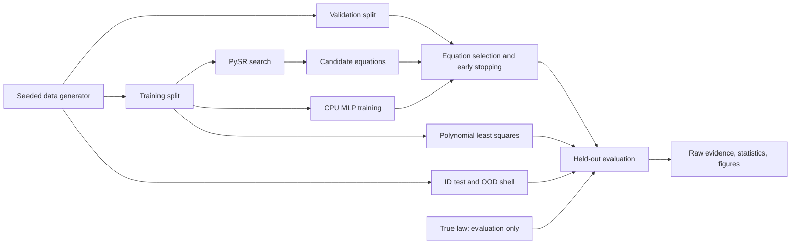
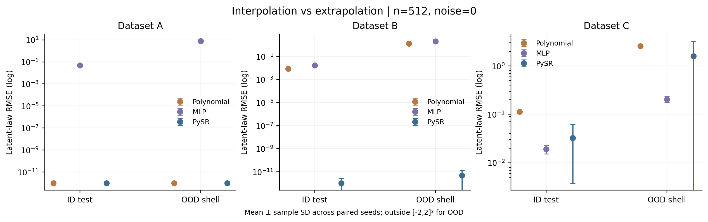
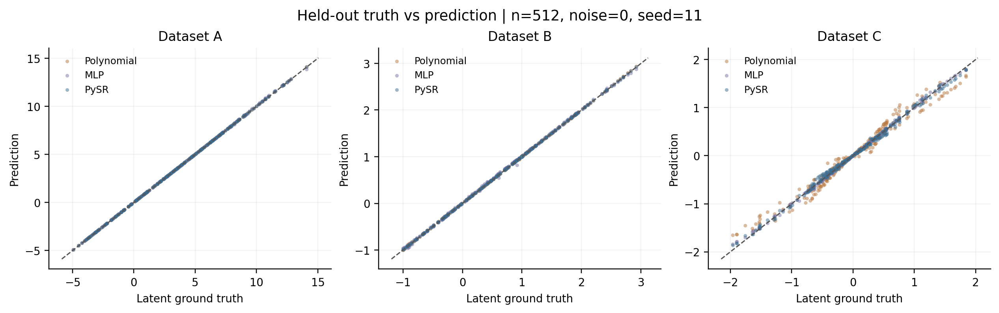
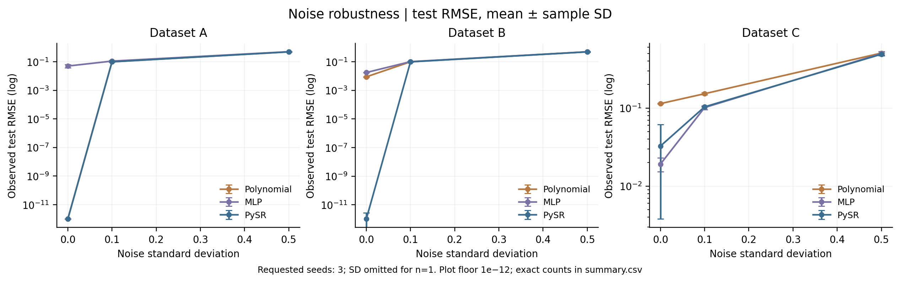
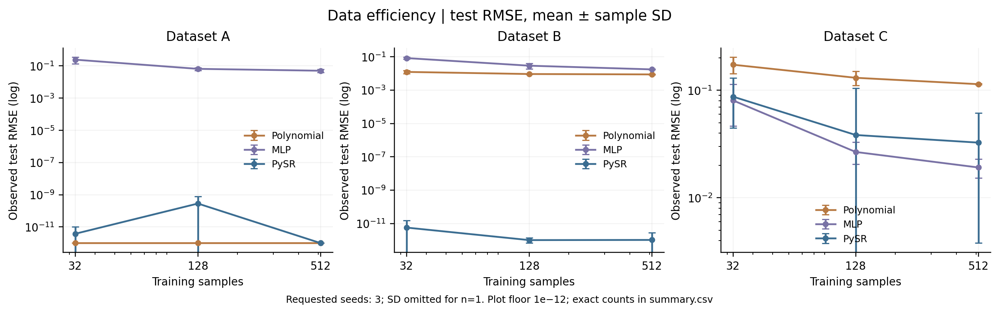
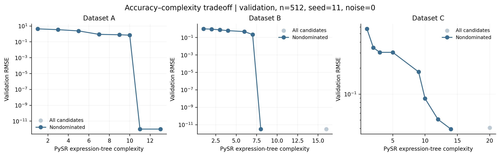

# 🔬 Symbolic Discovery Lab

<p align="center">
  <b>Discovering Mathematical Laws from Data</b><br/>
  <i>Symbolic regression · interpretable equations · reproducible CPU experiments</i>
</p>

<p align="center">
  
  
  
  <a href="LICENSE"></a>
  <a href="https://github.com/qinzhong631-ux/Symbolic-Discovery-Lab/actions/workflows/tests.yml"></a>
</p>

<p align="center">
  
  
  
</p>

<p align="center">
  <a href="#-method-overview">Methods</a> · <a href="#-quick-start">Quick Start</a> ·
  <a href="#-experiments--results">Results</a> · <a href="docs/EXPERIMENTS.md">Research Report</a> ·
  <a href="docs/VALIDATION.md">Verification</a>
</p>

---

## 🚀 Introduction

**Symbolic Discovery Lab** is a reproducible CPU research project comparing
symbolic regression, polynomial least squares and a PyTorch neural network on
three synthetic mathematical laws. It asks whether low prediction error also
means recovery of an interpretable law, and whether that law extrapolates beyond
the data used to fit it.

> **Research focus:** predicting a mathematical function, recovering its
> generating expression and extrapolating outside its training support are
> different tasks. This lab measures each one with preserved experimental evidence.

The original work here is the experimental pipeline, leakage controls, validation
selection, formula-recovery audit and evidence presentation. Symbolic search is
provided by [PySR](https://github.com/astroautomata/PySR); this project does not
claim to invent its evolutionary algorithm. It is independent of
[MiniGPT Lab](https://github.com/qinzhong631-ux/minigpt-lab), whose presentation
structure inspired the initial presentation. The visual layout also draws on
[GraphMeta](https://github.com/NoWall-572/GraphMeta_for_MAS); all code, scientific
content and figures here belong to this separate study.

---

## ✨ What Can You Explore?

| Capability | What the project does |
| --- | --- |
| 🧬 **Formula discovery** | Searches expression trees with upstream PySR and exports candidate equations. |
| 🧠 **Trainable baselines** | Compares polynomial least squares and a CPU PyTorch MLP with early stopping. |
| 🧪 **Controlled experiments** | Separates formula recovery, noise robustness, data efficiency and extrapolation. |
| 🔎 **Recovery audit** | Distinguishes algebraic equality, domain holes and tolerance-based agreement. |
| 📊 **Measured evidence** | Preserves paired-seed metrics, uncertainty, candidate fronts and five figure types. |
| 🖥️ **Interactive exploration** | Runs real Gradio experiments in isolated workers for reliable model switching. |

---

## 🧭 Quick Links

- **Repository:** [qinzhong631-ux/Symbolic-Discovery-Lab](https://github.com/qinzhong631-ux/Symbolic-Discovery-Lab)
- **Scientific protocol:** [experiments and interpretation](docs/EXPERIMENTS.md)
- **Algorithm notes:** [mathematics and implementation](docs/METHODS.md)
- **Measured results:** [135-fit study report](results/quick/REPORT.md)
- **Verification:** [actual commands and outcomes](docs/VALIDATION.md)
- **Publication and CI:** [GitHub release verification](docs/PUBLICATION.md)
- **Experiment config:** [quick CPU study](configs/quick.json)
- **Demo:** [local Gradio launcher](app.py)

### 📌 Recorded Study Snapshot

| Project at a glance | Recorded design |
| --- | --- |
| Laws | Polynomial, trigonometric and rational functions of two inputs |
| Models | PySR · degree-3 polynomial regression · two-layer Tanh MLP |
| Experiments | Formula recovery · noise robustness · data efficiency · extrapolation |
| Controls | Independent splits, nested train sizes, paired seeds, train-only scaling |
| Evidence | 135 successful three-model fits, three seeds, saved predictions and candidates |
| Platform | Windows CPU; Python 3.14.2, PySR 2.7.0, Julia 1.11.9 |

---

## 🧩 Method Overview



| Dataset | Ground truth | Research challenge |
| --- | --- | --- |
| A | `y = 2*x0² - 3*x1 + 1` | Exact low-degree representation |
| B | `y = sin(x0) + 0.5*x1²` | Structure versus local approximation |
| C | `y = x0 / (1 + x1²)` | Rational denominators and support shift |

True formulas are used only to generate labels and evaluate fitted expressions.
The model adapters accept arrays and generic hyperparameters, with no oracle
templates, coefficient guesses or dataset-specific formulas.

PySR searches with a shared compact grammar (`+`, `-`, `*`, `/`, `sin`), Float64,
serial seeded mode and maxsize=20. Validation RMSE selects a candidate from its
training front. The polynomial baseline uses train-only feature scaling and
ordinary least squares. The MLP uses train-only input/target scaling, full-batch
Adam and validation early stopping with restoration of its best checkpoint.
See [experimental protocol](docs/EXPERIMENTS.md) for all budgets and limitations.

---

## ⚡ Quick Start

### 1. Install

Use Python 3.11 or newer. The measured Julia study used Python 3.14.2 on Windows.
The published CPU CI matrix passed on Windows/Linux with Python 3.11 and 3.14;
Julia integration remains locally verified on Windows. See [publication checks](docs/PUBLICATION.md).

```powershell
git clone https://github.com/qinzhong631-ux/Symbolic-Discovery-Lab.git
cd Symbolic-Discovery-Lab
python -m venv .venv
.\.venv\Scripts\Activate.ps1
python -m pip install torch==2.14.1 --index-url https://download.pytorch.org/whl/cpu
python -m pip install -r requirements.txt
python -m pip install --no-deps -e .
```

On Linux/macOS use `source .venv/bin/activate`; use the appropriate
[official PyTorch build](https://pytorch.org/get-started/locally/) for your platform.
[Installation notes](docs/INSTALLATION.md) include WSL2 and baseline-only options.

### 2. Verify the fast CPU path

```powershell
python -m pytest -q
python -m symbolic_discovery run --config configs/smoke.json --output runs/smoke-new
```

The default smoke test runs real polynomial/MLP fits without downloading Julia.
Output directories must be empty: choose a new name to preserve prior evidence.

### 3. Initialize PySR and run all four experiments

```powershell
$env:JULIA_DEPOT_PATH = "$PWD\.julia"
$env:PYTHON_JULIACALL_THREADS = "1"
python scripts/check_pysr.py
python -m symbolic_discovery run --config configs/quick.json --output runs/quick-new
```

First PySR import automatically downloads compatible Julia and compiles its
packages. This took about **23.5 minutes** on the measured network/machine;
subsequent suites reuse the installation. Julia initializes before Torch in the
final runner. Thread count is fixed before import; serial search favors reproducibility.

Windows one-command helper after installation:

```powershell
.\scripts\run_experiments.ps1 -Profile quick
```

If Julia is unavailable, explicitly run the baselines; the saved model list
records that limitation:

```powershell
python -m symbolic_discovery run --config configs/quick.json --models polynomial mlp --output runs/baselines-new
```

### 4. Launch the interactive demo

```powershell
python app.py
```

Open the printed local address. Choose a dataset, noise, model, sample count and
seed. **Compare all** trains all three models on the same split. The demo shows
the true and discovered formulas, an x1=0 function slice, held-out scatter and
test/OOD metrics. Each request uses an isolated worker so repeated model switches
cannot reverse Julia/Torch initialization order; PySR requests pay startup/JIT again.
It records actual experiments under `runs/demo/`; failed models
are reported and excluded from its comparison. Single-run demo results are not
multi-seed benchmark evidence.

---

## 📊 Experiments & Results

The recorded quick study used seeds **11, 22, 33**, train sizes **32, 128, 512**,
noise SD **0, 0.1, 0.5**, and a 12-second/40-iteration/4-population PySR search cap
per fit. The union of the four experiments has five unique conditions per dataset,
giving **135 fits**; all completed. These short budgets are exploratory.

Below: n=512, zero noise, **clean latent-law RMSE**, mean ± sample SD across three seeds.
Values below floating-point precision should be read as numerical agreement.

| Dataset | Model | ID RMSE mean ± SD | OOD RMSE mean ± SD |
| --- | --- | --- | --- |
| A | mlp | 0.04967 ± 0.0118 | 7.656 ± 0.142 |
| A | polynomial | 3.763e-15 ± 1.47e-15 | 3.319e-14 ± 1.86e-14 |
| A | pysr | 6.104e-16 ± 4.97e-17 | 2.672e-15 ± 1.6e-16 |
| B | mlp | 0.01752 ± 0.000838 | 2.101 ± 0.102 |
| B | polynomial | 0.008745 ± 0.000443 | 1.317 ± 0.0955 |
| B | pysr | 1.023e-12 ± 1.77e-12 | 4.776e-12 ± 8.27e-12 |
| C | mlp | 0.01914 ± 0.00384 | 0.2044 ± 0.0263 |
| C | polynomial | 0.114 ± 0.00126 | 2.567 ± 0.0879 |
| C | pysr | 0.0326 ± 0.0288 | 1.593 ± 1.67 |

PySR and the polynomial baseline represent A to numerical precision. PySR
recovers B's structure, where a polynomial can approximate the ID range well
but loses accuracy outside it. On C, only one of three reference-condition
searches recovered the rational law: MLP had the lower mean ID/OOD error under
this budget. Search failures to recover a law are scientifically informative.
The data do not support a universal model ranking or a significance claim.



### Formula recovery

Symbolic recovery requires unrounded SymPy equality **plus finite unsimplified
evaluation on independent domain probes**. Algebraic equality alone can hide
removable singularities. Numerical recovery uses 1,030 probes at atol=rtol=1e-5
and is **not a proof of strict symbolic equivalence or full-domain equality**.

| Dataset | Symbolic + domain recovery | Numerical recovery | Seeds |
| --- | --- | --- | --- |
| A | 100.0% | 100.0% | 3 |
| B | 66.7% | 100.0% | 3 |
| C | 33.3% | 33.3% | 3 |

The B seed with a near-exact fitted coefficient passes numerical tolerance but
does not prove algebraic equality. All selected expressions and candidate fronts
are preserved in [raw formula results](results/quick/formula_recovery.csv).
An evaluation correction preserving arithmetic domain holes is documented in
[the research report](docs/EXPERIMENTS.md#evaluation-audit); initial records remain
available for auditing, and predictive error measurements were not changed.

<details>
<summary>All five experiment figures (PNG and editable SVG)</summary>






Each PNG has a neighboring SVG. Points are seed means and error bars are sample
SD; unavailable SD is omitted. Log plots use a 1e-12 display floor only. Exact raw
values and successful seed counts are in the CSVs. PySR validation fronts do not
use test data for candidate selection.

</details>

Full evidence: [design and interpretation](docs/EXPERIMENTS.md) ·
[generated run report](results/quick/REPORT.md) · [raw metrics](results/quick/metrics.csv) ·
[summary statistics](results/quick/summary.csv) · [run manifest](results/quick/manifest.json).

---

## 🔁 Reproducibility

Every run preserves configuration, package/environment versions, source SHA256
hashes, separate split data/hashes, model settings, candidate validation errors,
MLP learning curves, predictions, training durations and failed-fit traces.
Julia's measured dependency manifest is retained under `results/`.

```powershell
python -m symbolic_discovery plot --results results/quick
python -m symbolic_discovery reevaluate --results results/quick
python scripts/build_showcase.py
$env:RUN_PYSR_TESTS = "1"
python -m pytest -q
```

`plot` rebuilds figures/report. `reevaluate` recomputes formula checks from the
saved unrounded expressions without refitting. `build_showcase.py` rebuilds the
README's result tables. The optional Julia integration test exercises an actual
search; the default tests skip it explicitly. See [verification](docs/VALIDATION.md)
for the commands actually executed, their outcomes and environment limitations.

Direct dependencies are pinned; the transitive Python snapshot and Julia manifest
are audit records. Exact floating-point/search trajectories across machines are
not guaranteed, especially with wall-clock stopping. Model checkpoints are not
distributed; all reported predictions are included as CSV evidence.

---

## 🗂️ Repository Structure

```text
symbolic-discovery-lab/
├── src/symbolic_discovery/
│   ├── __init__.py, __main__.py, cli.py
│   ├── data.py                 # Independent ID/OOD splits and oracle generation
│   ├── metrics.py              # Predictive and algebraic/domain recovery checks
│   ├── experiments.py          # Paired conditions, audit records and aggregation
│   ├── runtime.py              # Versions, hashes and Julia-before-Torch startup
│   ├── plotting.py             # Five figures, PNG + editable SVG
│   ├── report.py               # Factual reports and saved-expression reevaluation
│   ├── demo.py, demo_worker.py # Gradio and isolated experiment workers
│   └── models/{symbolic,polynomial,mlp}.py
├── configs/{smoke,quick,reference}.json
├── tests/                      # Unit, pipeline, failure and opt-in Julia checks
├── scripts/                    # Backend check, HTTP demo check and one-command run
├── results/
│   ├── quick/                  # 135-fit three-model study
│   │   ├── manifest.json, metrics.csv, summary.csv, REPORT.md
│   │   ├── formula_recovery*.csv, evaluation_revision.json
│   │   ├── figures/            # Five PNG/SVG pairs
│   │   └── fits/<condition>/   # data.npz, hashes and per-model evidence
│   ├── baselines/              # 90-fit paired baseline study
│   ├── smoke/                  # Fast six-fit CPU verification
│   ├── smoke_all/              # Final integrated nine-fit verification
│   ├── backend_check/          # Real Julia initialization/search evidence
│   └── Julia{Project,Manifest}.toml, environment.freeze.txt, demo_check.json
├── docs/                       # Protocol, installation, review, validation, handoff
├── .github/workflows/tests.yml # Windows/Linux × Python 3.11/3.14 CPU CI
├── app.py
├── pyproject.toml, requirements.txt
├── LICENSE, CITATION.cff, licenses/THIRD_PARTY.md
└── HANDOFF.md
```

---

## 🧪 Limitations & Next Steps

Three synthetic laws and three seeds provide a controlled exploratory study,
not a broad real-world benchmark. Budgets are not compute matched. The polynomial
baseline is well specified for A, while a fixed Tanh MLP can saturate outside ID
support. Sine/division can induce spurious families or removable domain holes.
Finite probes cannot establish equality of full mathematical domains.

The larger five-seed [reference configuration](configs/reference.json) is provided
but **was not executed**. Next steps: evaluation-count-matched searches, declared
grammar ablations, wider OOD domains, correlated/noisy real measurements and
stronger uncertainty analysis. WSL2 remains unverified; the remote CPU CI matrix
passed on all four platform/Python combinations. Julia-enabled CI is opt-in.

---

## 📜 Citation & Acknowledgements

Please cite the upstream methods used in your experiments, including Miles
Cranmer's [PySR / SymbolicRegression.jl paper](https://arxiv.org/abs/2305.01582),
scikit-learn and PyTorch. See [third-party acknowledgements](licenses/THIRD_PARTY.md)
and [CITATION.cff](CITATION.cff). This project's original code is MIT licensed.

<p align="center">
  <b>🔬 Discover structure. 📊 Preserve evidence. 🧭 Test beyond the training range.</b>
</p>
