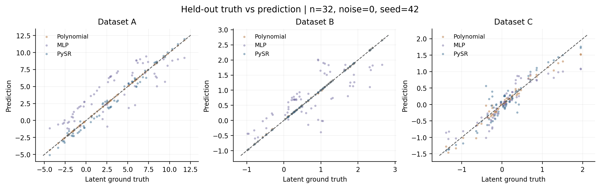
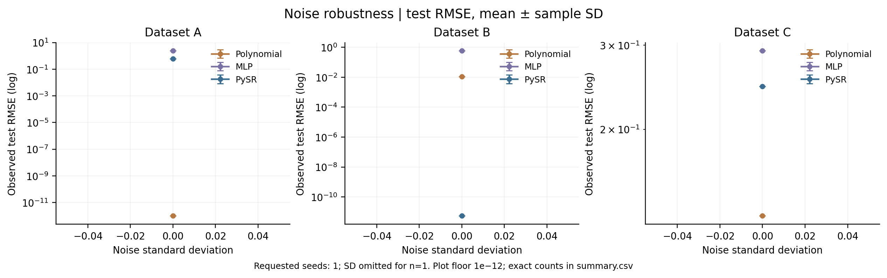
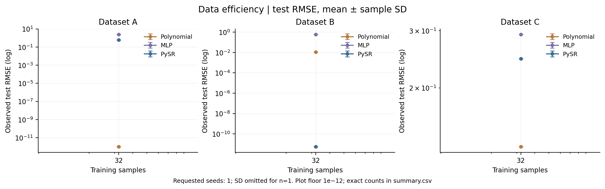
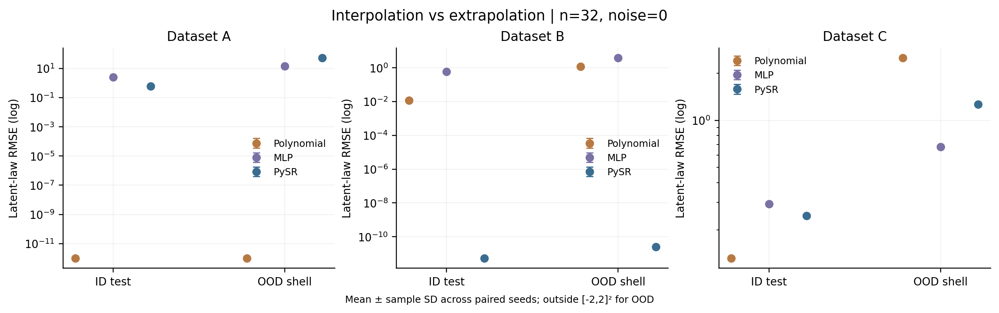
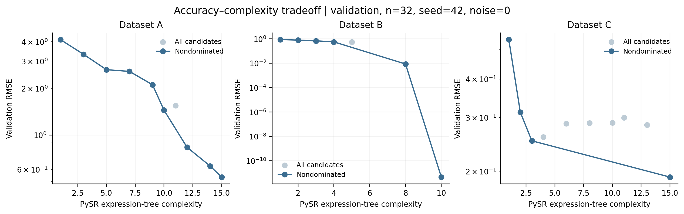

# Recorded experiment report

Status: **complete**. Successful fits: 9/9.

Paired seeds: `[42]`; train sizes: `[32]`; absolute noise SD: `[0.0]`. Reference n=32.

All values below are read from saved CSV/JSON files. Sample SD uses ddof=1; a single seed has no SD. Failures do not enter metric means.

## Protocol

ID inputs are uniform on [-2,2]². OOD inputs are uniform on the part of [-4,4]² outside that square. Independent streams generate each split. Train sizes are nested prefixes; held-out sets stay fixed. Observed targets include independent Gaussian noise; clean targets evaluate the latent law.

Polynomial degree is fixed before evaluation. Feature and target scaling use training data only. MLP restores its best validation checkpoint. PySR searches training data with one common operator grammar across datasets; validation RMSE selects its candidate. True formulas are never search inputs.

## Reference-condition results

| Dataset | Model | Split | Seeds | RMSE mean ± SD | MAE mean | R² mean | Fit seconds mean |
| --- | --- | --- | --- | --- | --- | --- | --- |
| A | mlp | ood | 1 | 14.38 ± n/a | 11.4 | -0.2728 | 5.2 |
| A | mlp | test | 1 | 2.422 ± n/a | 2.196 | 0.6594 | 5.2 |
| A | polynomial | ood | 1 | 3.033e-14 ± n/a | 2.436e-14 | 1 | 0.113 |
| A | polynomial | test | 1 | 3.962e-15 ± n/a | 3.128e-15 | 1 | 0.113 |
| A | pysr | ood | 1 | 52.35 ± n/a | 25.18 | -15.86 | 103 |
| A | pysr | test | 1 | 0.5967 ± n/a | 0.5099 | 0.9793 | 103 |
| B | mlp | ood | 1 | 3.836 ± n/a | 3.283 | -1.353 | 0.373 |
| B | mlp | test | 1 | 0.5917 ± n/a | 0.5173 | 0.5432 | 0.373 |
| B | polynomial | ood | 1 | 1.182 ± n/a | 0.6892 | 0.7767 | 0.0115 |
| B | polynomial | test | 1 | 0.01137 ± n/a | 0.008727 | 0.9998 | 0.0115 |
| B | pysr | ood | 1 | 2.492e-11 ± n/a | 2.042e-11 | 1 | 1.84 |
| B | pysr | test | 1 | 5.378e-12 ± n/a | 3.878e-12 | 1 | 1.84 |
| C | mlp | ood | 1 | 0.6787 ± n/a | 0.5609 | 0.616 | 0.173 |
| C | mlp | test | 1 | 0.2922 ± n/a | 0.2139 | 0.8077 | 0.173 |
| C | polynomial | ood | 1 | 2.505 ± n/a | 1.706 | -4.23 | 0.0138 |
| C | polynomial | test | 1 | 0.1317 ± n/a | 0.08728 | 0.9609 | 0.0138 |
| C | pysr | ood | 1 | 1.262 ± n/a | 1.071 | -0.3266 | 2.23 |
| C | pysr | test | 1 | 0.2459 ± n/a | 0.181 | 0.8638 | 2.23 |

## Formula recovery

Symbolic recovery requires SymPy to simplify the unrounded expression difference to exactly zero AND finite unsimplified evaluation on the probes. Algebraic equality alone can conceal removable domain holes; it is saved separately as symbolic_equivalent. Failure to prove zero is recorded as not proven, not mathematical inequivalence. Numerical recovery uses 1,030 independent ID/OOD/special-point probes, atol=rtol=1e-5; it is finite evidence of approximation and is **not** symbolic equivalence.

| Dataset | Model | Successful expressions | Symbolic + domain rate | Numerical rate |
| --- | --- | --- | --- | --- |
| A | polynomial | 1 | 0.0% | 100.0% |
| A | pysr | 1 | 0.0% | 0.0% |
| B | polynomial | 1 | 0.0% | 0.0% |
| B | pysr | 1 | 0.0% | 100.0% |
| C | polynomial | 1 | 0.0% | 0.0% |
| C | pysr | 1 | 0.0% | 0.0% |

### Selected expressions (first recorded seed)

- A / polynomial: `4.938327688443905e-16*x0**3 + 7.030339430546249e-17*x0**2*x1 + 1.9999999999999982*x0**2 + 1.16866948738382e-15*x0*x1**2 + 2.9715706392474193e-16*x0*x1 - 2.420978224569883e-15*x0 - 6.886378374487235e-16*x1**3 + 1.4963007482979162e-15*x1**2 - 2.9999999999999973*x1 + 1.0000000000000009` (PySR complexity: nan; SymPy nodes: 44)
- A / pysr: `(x0*sin(x0) + x0/sin(x0) - x1)*2.9075714219370665 - 1*2.826978405987586` (PySR complexity: 15.0; SymPy nodes: 17)
- B / polynomial: `-0.1306262800333267*x0**3 + 0.0026850683192044976*x0**2*x1 - 0.002373447701976607*x0**2 + 0.003106490691242788*x0*x1**2 - 0.0011275790709497956*x0*x1 + 0.9632476751165402*x0 + 8.394491651487857e-5*x1**3 + 0.4960440742270421*x1**2 - 0.003317560914575834*x1 + 0.008583260232359669` (PySR complexity: nan; SymPy nodes: 44)
- B / pysr: `x1*0.4240669399623023*x1/0.8481338799296012 + sin(x0)` (PySR complexity: 10.0; SymPy nodes: 8)
- C / polynomial: `0.001976875345634529*x0**3 + 0.027468226422307344*x0**2*x1 - 0.038013345477454066*x0**2 - 0.19281421295542425*x0*x1**2 - 0.05063204204650872*x0*x1 + 0.8509353749166936*x0 - 0.014961404661635255*x1**3 + 0.007021637401548783*x1**2 + 0.02032818291216206*x1 - 0.024020534661740943` (PySR complexity: nan; SymPy nodes: 44)
- C / pysr: `sin((x0/1.4823744766689622 + x1)/1.4823744766689622) + sin(x0/1.4823744766689622 - x1)` (PySR complexity: 15.0; SymPy nodes: 17)

## Figures

## Limitations and evidence boundaries

- These are synthetic two-variable laws, not a real-data benchmark.
- Search is budget limited and stochastic. No algorithm is assumed superior.
- Seed SD is not a confidence interval or a significance test.
- Time budgets, epoch budgets and degree constraints are not compute matched.
- PySR timing includes first-use initialization/JIT where incurred; other fits reuse the process. Per-fit timing scopes are saved in model.json.
- Wall-clock stopping can change search trajectories even in serial mode.
- PySR tree complexity, SymPy node count and MLP parameter count differ.
- Finite numeric probes cannot prove equality of full mathematical domains.
- Saved CSVs preserve measured predictions. Reruns reproduce the protocol; wall-clock search limits and hardware can change selected equations.

## Failed fits

None.

## Reproduction

The complete config, environment versions, source SHA256 hashes, data SHA256 hashes and per-fit parameters are in manifest.json and fits/. metrics.csv is the raw metric source; summary.csv contains group means/SD. Regenerate figures with `python -m symbolic_discovery plot --results PATH`.
